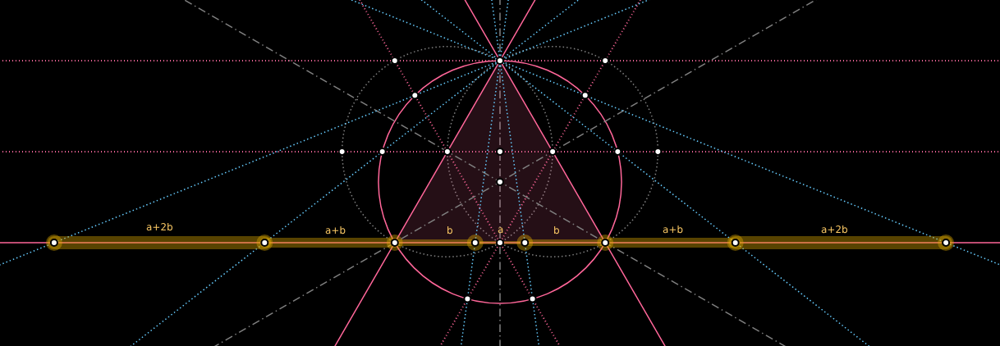

GEOMETOR • geometor.com
=======================

**Visit the Online Archive:** https://geometor.com

**GEOMETOR • Central portal to the interconnected semantic digital archive**

Mission
-------

``geometor/geometor.com`` is the central portal and gateway to the interconnected `GEOMETOR <https://geometor.com>`_ semantic digital archive. It unites 2,400 years of classical treatises, constructive geometry, natural morphogenesis, epistemological philosophy, and machine reasoning into a single coherent, addressable knowledge universe. Grounded in exact SymPy symbolic algebra, the archive liberates 74 Book Codices across 39 landmark authors and 11 Mathematical Catalogs from static print bounds into living, verifiable geometric systems.

Capabilities & Interactive Docs
-------------------------------

- `GEOMETOR Central Portal <https://geometor.com>`_ — Main threshold, interactive Vesica-to-phi construction scrubber, and corpus architecture.
- `Books & Mathematical Catalogs <https://geometor.com/books/>`_ — Comprehensive directory of all **74 Book Codices** (39 historical authors) and **11 Mathematical Catalogs** (over 8,400 archival folios and 16,000+ calibrated SVGs).
- `Projects Architecture <https://geometor.com/projects/>`_ — Complete 61-repository map across symbolic core, constructive canon, philosophical scriptorium, morphogenesis, and machine reasoning.
- `Philosophical Foundations <https://geometor.com/foundations/>`_ — Epistemological and noetic principles (*materia intelligibilis*, earned understanding, and exact algebra).
- `Historical Lineage <https://geometor.com/lineage/>`_ — Intellectual genealogy connecting Euclid, Apollonius, and Archimedes through Pacioli, Kepler, Euler, and modern synthetic geometry.
- `Visual Broadcasts <https://geometor.com/broadcasts/>`_ — High-definition animated construction walkthroughs and video expositions on `@geometor <https://www.youtube.com/@geometor>`_.

Repository Contents
-------------------

- ``docsrc/`` — Master portal narrative, books directory, lineage guides, and Sphinx templates compiled by `PHOTON publish <https://github.com/photon-platform/publish>`_.
- ``scripts/`` — Hero diagram generators, census scripts, and asset builders.

Local Build & Verification
--------------------------

.. code-block:: bash

   publish build

Part of the GEOMETOR Knowledge Archive
--------------------------------------

Explore all **74 Book Codices** and **11 Mathematical Catalogs** at https://geometor.com/books/.

