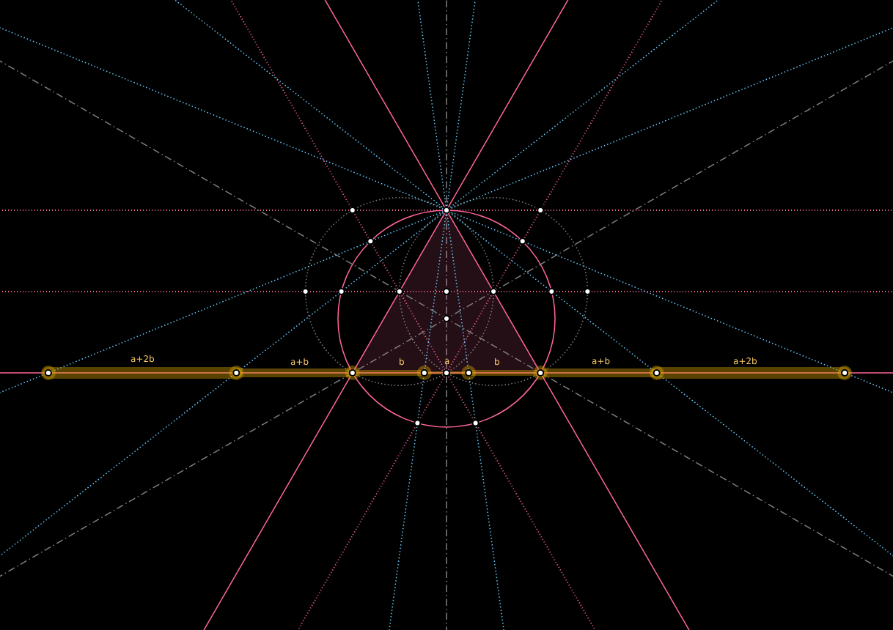
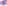
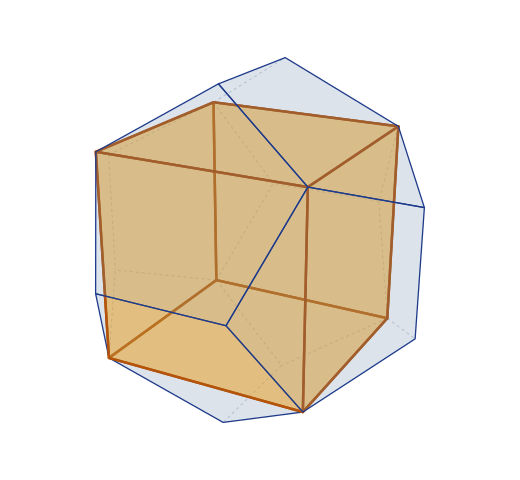
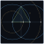
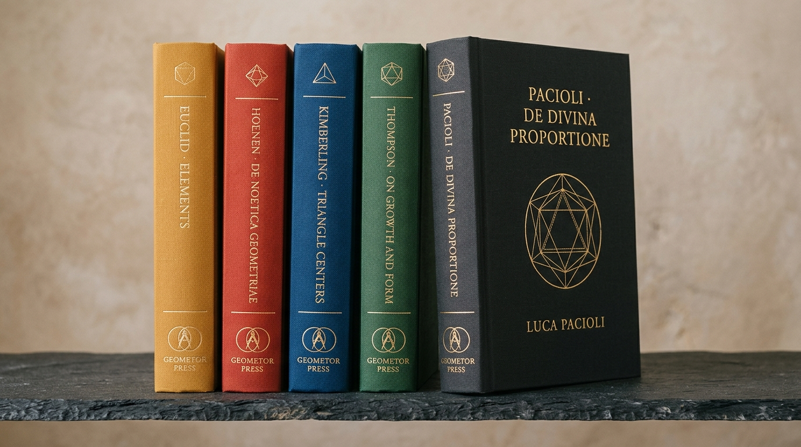

I. The Symbolic Core, Discovery & Software Catalog
==================================================

.. rubric:: Exact Algebraic Modeling, Interactive Visualization, Golden Discovery & Prover Catalog

The symbolic core provides the mathematical substrate on which every GEOMETOR construction, verification script, and studio broadcast runs—paired with structured catalogs of golden constructions and open-source geometric proving engines.

----

``model`` — The Symbolic Construction Engine
--------------------------------------------

* **Documentation**: `geometor.github.io/model <https://geometor.github.io/model/>`_
* **Repository**: `github.com/geometor/model <https://github.com/geometor/model>`_ · **PyPI**: `geometor-model <https://pypi.org/project/geometor-model/>`_

``geometor.model`` implements compass-and-straightedge geometry in pure symbolic algebra (`SymPy <https://www.sympy.org/>`_):

* **Exact Primitives & Closed-Form 2D Intersections**: Points, infinite lines ``[ A B ]``, circles ``( A B )``, segments ``/ A B /``, polygons ``< A B C >``, wedges, and polynomial loci—with fast closed-form algebraic intersection deduplication and scoped subconstructions.
* **Rational & Projective Invariants (`invariants.py`)**: Exact symbolic ``quadrance``, ``line_spread``, ``vertex_spread``, ``cross``, ``cross_ratio``, and ``is_harmonic`` verification without transcendental rounding error.
* **Constructive Proof & Ancestral DAGs (`proof.py`, `ancestors.py`)**: Every derived point records the exact ancestral chain of givens, lines, and circles required to construct it, paired with ``@proposition`` deductive step ledgers and JSON serialization.

----

``explorer`` — Interactive SVG Workbench
----------------------------------------

* **Documentation**: `geometor.github.io/explorer <https://geometor.github.io/explorer/>`_
* **Repository**: `github.com/geometor/explorer <https://github.com/geometor/explorer>`_

``geometor.explorer`` unifies visual inspection, interactive construction, and print/video SVG export:

* **Web Canvas & Symbolic CLI**: Construct and inspect ``geometor.model`` figures interactively in the browser with pan/zoom SVG viewports, KaTeX algebraic coordinate inspection, and ancestral highlighting.
* **Step-by-Step Timeline & Sheet Export**: Scrub through construction history step by step or export publication-grade vector figures for Sphinx Book Codices and QHD broadcasts.

----

``divine`` — Golden Ratio Discovery & *Cut-the-Knot* Construction Catalog
-------------------------------------------------------------------------

* **Documentation & Catalog**: `geometor.github.io/divine <https://geometor.github.io/divine/>`_ (`Constructions Catalog <https://geometor.github.io/divine/constructions/>`_)
* **Repository**: `github.com/geometor/divine <https://github.com/geometor/divine>`_ · **PyPI**: `geometor-divine <https://pypi.org/project/geometor-divine/>`_

Once a model is constructed, ``geometor.divine`` scans every collinear point set on every line in the field to uncover emergent proportional structures—and now pairs the discovery engine with a structured **Mathematical Catalog** inspired by Alexander Bogomolny's *Cut-the-Knot* golden ratio archive:

* **Exact Golden Sections & Chains**: Identifies collinear triples :math:`(A, B, C)` whose segment ratios simplify algebraically to :math:`\phi = \frac{1 + \sqrt{5}}{2}` or :math:`\phi^{-1}`, grouping contiguous golden sections into self-similar chains and harmonic quadruples :math:`(A, B; C, D) = -1`.
* **Catalog of Classical & Modern Golden Constructions**: One-item-per-page ``geometor.model`` constructions and proofs spanning Euclid II.11/VI.30, Ptolemy's pentagon-decagon, George Odom's equilateral midline, Kurt Hofstetter's 5-step compass constructions, and Tran Quang Hung / Michel Bataille circle configurations.

----

``codes`` — Catalog of Geometric Computing & Theorem-Proving Engines
--------------------------------------------------------------------

* **Live Catalog**: `geometor.github.io/codes <https://geometor.github.io/codes/>`_
* **Repository**: `github.com/geometor/codes <https://github.com/geometor/codes>`_

A structured architectural **Catalog** surveying the landscape of open-source deductive provers, algebraic geometry kernels, and dynamic geometry systems alongside ``geometor.model``:

* **Formal & Synthetic Provers**: *GeoCoq* (Tarski & Hilbert axiomatics in Coq/Rocq), *Java Geometry Expert (JGEX)* (Chou–Gao–Zhang Area & Full-Angle Methods producing human-readable proofs), and Wu's Characteristic Set / Gröbner Basis elimination (*GeoGebra Discovery*).
* **Exact & Computational Kernels**: *SymPy Geometry*, *CGAL* (exact geometric predicates), *Cinderella* (projective Riemann-sphere continuity), and Rational Trigonometry algebra.

----

``polyhedra`` — Symbolic 3D Polyhedra & Leonardo's 1509 Plates Catalog
----------------------------------------------------------------------

* **Live Catalog**: `geometor.github.io/polyhedra <https://geometor.github.io/polyhedra/>`_ (`Solids <https://geometor.github.io/polyhedra/solids/>`_ · `Leonardo Plates <https://geometor.github.io/polyhedra/leonardo/>`_)
* **Repository**: `github.com/geometor/polyhedra <https://github.com/geometor/polyhedra>`_

Exact symbolic 3D coordinate models over quadratic and golden fields (:math:`\mathbb{Q}(\sqrt{2}, \sqrt{3}, \phi)`) spanning the Platonic, Archimedean, Catalan, and Kepler–Poinsot polyhedra, paired with interactive reconstructions of Leonardo da Vinci's 60 *solido* and *vacuo* plates from Luca Pacioli's 1509 *De Divina Proportione*.

----

``elementarium`` — Passive Optical Archive & Zero-Context Bootstrap
-------------------------------------------------------------------

* **Documentation**: `geometor.github.io/elementarium <https://geometor.github.io/elementarium/>`_
* **Repository**: `github.com/geometor/elementarium <https://github.com/geometor/elementarium>`_

Investigates 100,000-year knowledge preservation on fused-silica optical plates: bootstrapping number, rational spread, the Vesica Piscis, and Euclidean deduction from zero linguistic context using purely geometric optical invariants.

----

``press`` — Digital Scriptorium Press & Master Shelf
----------------------------------------------------

* **Documentation**: `geometor.github.io/press <https://geometor.github.io/press/>`_
* **Repository**: `github.com/geometor/press <https://github.com/geometor/press>`_

Curates the master bibliographic census, typographic grid, cover geometry, and print-edition specifications across the GEOMETOR Digital Scriptorium.

----

``animations`` & ``trees`` — Proportional Studies & Monotone Tree Layouts
-------------------------------------------------------------------------

* **Live Sites**: `geometor.github.io/animations <https://geometor.github.io/animations/>`_ · `geometor.github.io/trees <https://geometor.github.io/trees/>`_
* **Repositories**: `github.com/geometor/animations <https://github.com/geometor/animations>`_ · `github.com/geometor/trees <https://github.com/geometor/trees>`_

``animations`` documents classical golden-section studies, root-:math:`3` and root-:math:`5` grids, and star polygon sequences; ``trees`` implements crossing-free monotone planar drawings of rooted dependency trees grounded in **Stern–Brocot mediant trees** and **Farey rational sequences**.
