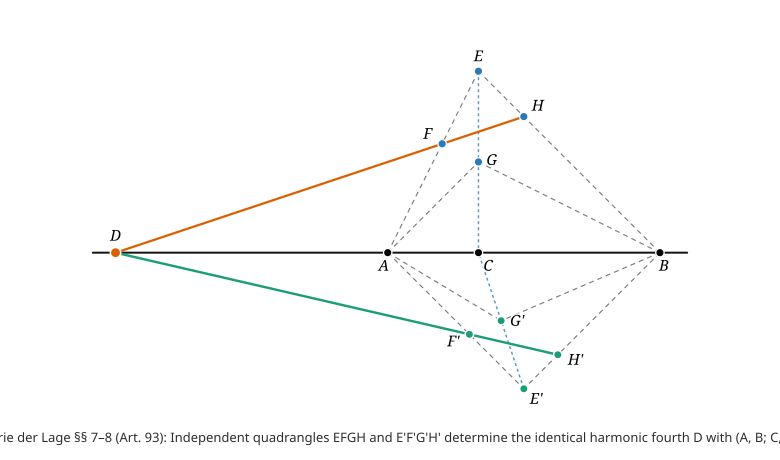
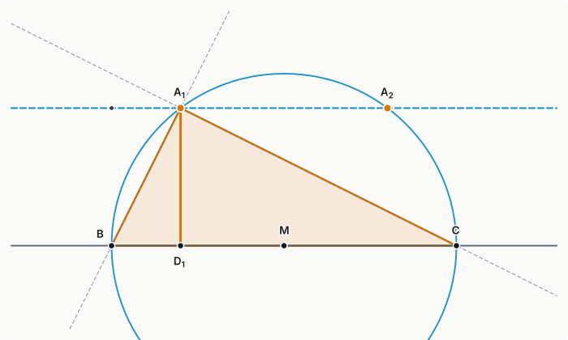
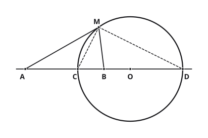

II. The Unfolding Canon (*The Elementrium* & Constructive Geometry)
===================================================================

.. rubric:: Classical Synthesis, Conics, Spherical & Projective Geometry, Triangle Centers & Rational Trigonometry

Pillar II recasts foundational mathematical treatises and modern synthetic canons into interactive **Book Codices** (for public-domain treatises) and **Mathematical Catalogs** (for modern research archives), where historical prose, formal pseudocode, exact ``SymPy`` proofs, and vector diagrams illuminate one another.

----

``euclid`` — Euclid's *Elements* (Books I–XIII) & *Data* (*Δεδομένα*)
---------------------------------------------------------------------

* **Live Book Codex**: `geometor.github.io/euclid <https://geometor.github.io/euclid/>`_ (`Euclid's Data <https://geometor.github.io/euclid/data/>`_)
* **Repository**: `github.com/geometor/euclid <https://github.com/geometor/euclid>`_

Complete three-volume critical digital edition of Sir Thomas L. Heath's *Euclid's Elements* (**1,416 archival folios**, **465 propositions**, **831 calibrated interactive SVGs** in a 2-Track Codex), paired with a 4-Track Greek/English Book Codex of Euclid's companion treatise on geometric analysis, the **Data** (*Δεδομένα*, **94 propositions** grounded in Heiberg/Menge Teubner editions).

----

``elements`` — Elements 2.0 & The 601-Node G-Index
--------------------------------------------------

* **Live Book Codex**: `geometor.github.io/elements <https://geometor.github.io/elements/>`_
* **Repository**: `github.com/geometor/elements <https://github.com/geometor/elements>`_ · **Broadcasts**: `YouTube Playlist <https://www.youtube.com/playlist?list=PLUXlBs_QySgw>`_

Codifies Euclid's logical dependency DAG into the sequential **G-Index** (``G.1`` through ``G.601``), ensuring no definition, postulate, common notion, or proposition is invoked before its prerequisites are established across *Formal Pseudocode*, *Executable Python*, *Heath Prose*, and *QHD Studio Broadcasts*.

----

``byrne`` — Oliver Byrne's *First Six Books of the Elements of Euclid* (1847)
-----------------------------------------------------------------------------

* **Live Book Codex**: `geometor.github.io/byrne <https://geometor.github.io/byrne/>`_
* **Repository**: `github.com/geometor/byrne <https://github.com/geometor/byrne>`_

Scholarly edition analyzing Oliver Byrne's celebrated 1847 William Pickering edition as **visual geometric pseudocode**: inline red, yellow, blue, and black line/angle/area glyphs eliminate letter-label indirection, cross-linked to Nicholas Rougeux's digital typography study and GEOMETOR's G-Index.

----

``archimedes`` — *Works of Archimedes* & *The Mechanical Method*
----------------------------------------------------------------

* **Live Book Codex**: `geometor.github.io/archimedes <https://geometor.github.io/archimedes/>`_
* **Repository**: `github.com/geometor/archimedes <https://github.com/geometor/archimedes>`_

Grounded in T. L. Heath's 1897 and 1912 Cambridge editions: *Measurement of a Circle* (exact 96-gon rational bounds :math:`3\frac{10}{71} < \pi < 3\frac{1}{7}`), *Quadrature of the Parabola*, *On Spirals*, *On the Sphere and Cylinder*, the *Book of Lemmas* (*Arbelos* & *Salinon*), and *The Method of Mechanical Theorems*.

----

``apollonius`` — Apollonius of Perga's *Treatise on Conic Sections*
-------------------------------------------------------------------

* **Live Book Codex**: `geometor.github.io/apollonius <https://geometor.github.io/apollonius/>`_
* **Repository**: `github.com/geometor/apollonius <https://github.com/geometor/apollonius>`_

Book Codex of Heath's 1896 edition spanning Books I–VII on the symptomata of parabola, ellipse, and hyperbola cut from a single oblique circular cone, conjugate diameters, harmonic poles and polars, normals/evolutes, minimum and maximum lines, and Pappus reconstructions of Apollonius's lost analytical treatises.

----

``heron`` — Heron of Alexandria's *Metrica* & *Dioptra*
-------------------------------------------------------

* **Live Book Codex**: `geometor.github.io/heron <https://geometor.github.io/heron/>`_
* **Repository**: `github.com/geometor/heron <https://github.com/geometor/heron>`_

4-Track Greek/English Codex (Schöne 1903 Teubner critical text + original English) of *Metrica* Books I–III: **Heron's Area Formula** (:math:`\Delta = \sqrt{s(s-a)(s-b)(s-c)}`, identical to Rational Trigonometry's Archimedes/Quadrea formula), iterative rational square-root extraction, regular polygons, Platonic/Archimedean solid volumes, and proportional division of figures.

----

``menelaus`` — Menelaus of Alexandria's *Sphaerica*
---------------------------------------------------

* **Live Book Codex**: `geometor.github.io/menelaus <https://geometor.github.io/menelaus/>`_
* **Repository**: `github.com/geometor/menelaus <https://github.com/geometor/menelaus>`_

Multi-track edition of Books I–III of Menelaus's *Sphaerica*: intrinsic geometry of spherical triangles without Euclid's parallel postulate (*AAA congruence*), **Menelaus's Planar & Spherical Transversal Theorems** (signed 6-segment ratio product :math:`= -1`), and projective cross-ratio invariance.

----

``ptolemy`` — Claudius Ptolemy's *Almagest* (Book I) & *Planisphaerium*
-----------------------------------------------------------------------

* **Live Book Codex**: `geometor.github.io/ptolemy <https://geometor.github.io/ptolemy/>`_
* **Repository**: `github.com/geometor/ptolemy <https://github.com/geometor/ptolemy>`_

4-Track Greek/Latin/English Codex (Heiberg 1898/1907 Teubner editions + original English): **Ptolemy's single-circle Golden Pentagon–Decagon construction** (*Almagest* I.10), **Ptolemy's Theorem on Cyclic Quadrilaterals**, exact radical & sexagesimal chord tables, spherical Menelaus astronomy, and **stereographic projection** of the astrolabe (*Planisphaerium*).

----

``pappus`` — Pappus of Alexandria's *Synagoge* (*Collection*)
-------------------------------------------------------------

* **Live Book Codex**: `geometor.github.io/pappus <https://geometor.github.io/pappus/>`_ (`Synagoge <https://geometor.github.io/pappus/synagoge/>`_ · `Theorems <https://geometor.github.io/pappus/theorems/>`_)
* **Repository**: `github.com/geometor/pappus <https://github.com/geometor/pappus>`_

4-Track Greek/English Book Codex of Pappus's *Synagoge* (Hultsch 1876–1878, **445 folios**): Book III Three Means in a Semicircle, Book IV Generalized Pythagoras & Arbelos Circle Chain :math:`h_n = n d_n`, Book V Honeycomb Isoperimetry, Book VII *Domain of Analysis*, Cross-Ratio & Hexagon Lemma, and Book VIII Mechanics, paired with exact ``SymPy`` projective configurations.

----

``pascal`` — Blaise Pascal's *Essay pour les Coniques* (1640)
-------------------------------------------------------------

* **Live Book Codex**: `geometor.github.io/pascal <https://geometor.github.io/pascal/>`_ (`Essay pour les Coniques <https://geometor.github.io/pascal/essay_coniques_1640/>`_)
* **Repository**: `github.com/geometor/pascal <https://github.com/geometor/pascal>`_

4-Track French/English Book Codex of Pascal's 1640 Paris broadside generalizing Pappus's hexagon theorem to any six points inscribed on a conic section, accompanied by exact symbolic verification of the **60 Pascal lines**, **20 Steiner points**, and **60 Kirkman points** of the *Hexagrammum Mysticum*.

----

``ceva`` — Giovanni Ceva's *De lineis rectis se invicem secantibus statica constructio* (1678)
----------------------------------------------------------------------------------------------

* **Live Book Codex**: `geometor.github.io/ceva <https://geometor.github.io/ceva/>`_
* **Repository**: `github.com/geometor/ceva <https://github.com/geometor/ceva>`_

4-Track Latin/English Codex (**126 folios**) of Ceva's 1678 Milan quarto treatise elevating Archimedes' Law of the Lever into a universal engine of projective concurrency: **Ceva's Theorem** for interior and exterior cevians (:math:`X_1, X_2, X_4, X_6, X_7, X_8`), static rediscovery of Menelaus's Theorem, odd-polygon ratio products, and 4-weight 3D tetrahedron concurrency.

----

``euler`` — Leonhard Euler's *Solutio facilis* (*E325*, 1765)
-------------------------------------------------------------

* **Live Book Codex**: `geometor.github.io/euler <https://geometor.github.io/euler/>`_ (`Solutio facilis <https://geometor.github.io/euler/solutio_facilis_1765/>`_)
* **Repository**: `github.com/geometor/euler <https://github.com/geometor/euler>`_

4-Track Latin/English Codex (**38 folios** from the *Novi Commentarii Academiae Scientiarum Imperialis Petropolitanae*) deriving the exact algebraic quadrances between orthocenter, centroid, circumcenter, and incenter—proving the :math:`2:1` collinearity of the **Euler Line** (:math:`X_4, X_2, X_3`) and **Euler's Incenter–Circumcenter Theorem** :math:`OI^2 = R^2 - 2Rr`.

----

``mascheroni`` — Lorenzo Mascheroni's *La Geometria del Compasso* (1797)
------------------------------------------------------------------------

* **Live Book Codex**: `geometor.github.io/mascheroni <https://geometor.github.io/mascheroni/>`_ (`La Geometria del Compasso <https://geometor.github.io/mascheroni/geometria_del_compasso/>`_)
* **Repository**: `github.com/geometor/mascheroni <https://github.com/geometor/mascheroni>`_

4-Track Italian/English Codex (**181 folios**, Pavia 1797) proving the **Mohr–Mascheroni Theorem**: every compass-and-straightedge construction of Euclidean geometry—including circle bisection, regular polygon division, and line-circle/line-line intersection—can be executed with the **compass alone**.

----

``feuerbach`` — Karl Wilhelm Feuerbach's *Eigenschaften* (1822)
---------------------------------------------------------------

* **Live Book Codex**: `geometor.github.io/feuerbach <https://geometor.github.io/feuerbach/>`_ (`Eigenschaften <https://geometor.github.io/feuerbach/feuerbach_1822/>`_)
* **Repository**: `github.com/geometor/feuerbach <https://github.com/geometor/feuerbach>`_

4-Track German/English Codex (**76 folios**, Nuremberg 1822) proving that the **Nine-Point Circle** (center :math:`X_5`, radius :math:`R/2`) touches the incircle internally at **Feuerbach's Point (:math:`X_{11}`)** and all three excircles externally.

----

``steiner`` — Jakob Steiner's *Die geometrischen Constructionen* (1833)
-----------------------------------------------------------------------

* **Live Book Codex**: `geometor.github.io/steiner <https://geometor.github.io/steiner/>`_ (`Die geometrischen Constructionen <https://geometor.github.io/steiner/constructionen_1833/>`_)
* **Repository**: `github.com/geometor/steiner <https://github.com/geometor/steiner>`_

4-Track German/English Codex (**94 folios**, Berlin 1833 / Ostwald's Klassiker 1895) proving the **Poncelet–Steiner Theorem**: given a single fixed circle and its center drawn once on the plane, every Euclidean construction can be performed with the **unmarked straightedge alone** via harmonic ranges and polarities.

----

``staudt`` — Karl Georg Christian von Staudt's *Geometrie der Lage* (1847) & *Beiträge* (1856–60)
-------------------------------------------------------------------------------------------------

* **Live Book Codex**: `geometor.github.io/staudt <https://geometor.github.io/staudt/>`_
* **Repository**: `github.com/geometor/staudt <https://github.com/geometor/staudt>`_

Bilingual German/English Codex emancipating projective geometry from metric distance: Möbius harmonic nets, harmonic fourths by straightedge alone, von Staudt's **Algebra of Throws (*Würfe*)** adding and multiplying collinear points projectively, conic polarities, and his projective construction of the regular 17-gon.

----

``petersen`` — Julius Petersen's *Methods and Theories for Geometrical Constructions* (1879)
--------------------------------------------------------------------------------------------

* **Live Book Codex**: `geometor.github.io/petersen <https://geometor.github.io/petersen/>`_
* **Repository**: `github.com/geometor/petersen <https://github.com/geometor/petersen>`_

Systematic Book Codex of Petersen's classic heuristic treatise: solving constructive problems via **intersection of two loci** (culminating in Gergonne/Petersen's solution to Apollonius's Problem of three tangent circles), parallel translation, rotation/spiral similarity, homothety, and circular inversion.

----

``casey`` — John Casey's *A Sequel to the First Six Books of the Elements of Euclid* (1888)
-------------------------------------------------------------------------------------------

* **Live Book Codex**: `geometor.github.io/casey <https://geometor.github.io/casey/>`_
* **Repository**: `github.com/geometor/casey <https://github.com/geometor/casey>`_

Bridges Euclid Books I–VI to nineteenth-century circle and triangle synthesis: coaxial circles, inversion, **Casey's Generalized Ptolemy Theorem** on four circles tangent to a fifth (:math:`t_{12}t_{34} \pm t_{13}t_{24} \pm t_{14}t_{23} = 0`, yielding an immediate algebraic proof of Feuerbach's Theorem), and Lemoine–Brocard–Neuberg geometry.

----

``lemoine`` — Émile Lemoine's *Géométrographie, ou Art des constructions géométriques* (1902)
---------------------------------------------------------------------------------------------

* **Live Book Codex**: `geometor.github.io/lemoine <https://geometor.github.io/lemoine/>`_
* **Repository**: `github.com/geometor/lemoine <https://github.com/geometor/lemoine>`_

Bilingual French/English Codex of Lemoine's operational complexity calculus counting five elementary ruler-and-compass primitives (:math:`R_1, R_2, C_1, C_2, C_3`) to measure **Simplicity** (:math:`S`) and **Exactness** (:math:`E`) across classical constructions, paired with Lemoine's **Symmedian Point (:math:`X_6`)** and Lemoine circles.

----

``klein`` — Felix Klein's *Erlangen Program* (1872) & *Famous Problems of Elementary Geometry* (1895)
-----------------------------------------------------------------------------------------------------

* **Live Book Codex**: `geometor.github.io/klein <https://geometor.github.io/klein/>`_
* **Repository**: `github.com/geometor/klein <https://github.com/geometor/klein>`_

Dual German/English Codex uniting Klein's 1872 **Erlangen Program** (classifying Euclidean, affine, projective, and hyperbolic geometries as invariants of transformation groups) with his 1895 Göttingen lectures proving the impossibility of cube duplication and angle trisection, **Gauss's Gaussian-period construction of the regular 17-gon**, and Hermite–Lindemann transcendence of :math:`e` and :math:`\pi`.

----

``altshiller-court`` — Nathan Altshiller-Court's *College Geometry*
-------------------------------------------------------------------

* **Live Book Codex**: `geometor.github.io/altshiller-court <https://geometor.github.io/altshiller-court/>`_
* **Repository**: `github.com/geometor/altshiller-court <https://github.com/geometor/altshiller-court>`_

One-item-per-page proposition codex with exact symbolic `.euclid-graphic` hero figures and calibrated diagrams across 10 chapters—training the four-stage constructive discipline (*Analysis, Construction, Proof, Discussion*) across geometric loci, similitude, the Nine-Point Circle and Feuerbach's Theorem, the Simson Line, Menelaus and Ceva, Harmonic Division, Inversion, and Brocard geometry.

----

``fundamentals`` — The Fred W. Seelig Constructive Archive
----------------------------------------------------------

* **Live Book Codex**: `geometor.github.io/fundamentals <https://geometor.github.io/fundamentals/>`_
* **Repository**: `github.com/geometor/fundamentals <https://github.com/geometor/fundamentals>`_

Preserves and executes the mathematical notebooks of **Fred W. Seelig** across **55 foundational topics** (``F.1``–``F.55``), **353 manuscript folios**, and **59 analytical spreadsheets** in a 3-Track Codex.

----

``etc`` — Catalog: Clark Kimberling's *Encyclopedia of Triangle Centers*
------------------------------------------------------------------------

* **Live Mathematical Catalog**: `geometor.github.io/etc <https://geometor.github.io/etc/>`_
* **Repository**: `github.com/geometor/etc <https://github.com/geometor/etc>`_ · **Broadcasts**: `YouTube Playlist <https://www.youtube.com/playlist?list=PLKVZJpKGr5zc>`_

Symbolic **Catalog** documenting Clark Kimberling's *Encyclopedia of Triangle Centers* (**53,144 centers parsed**; **4,000+ centers compiled** across **62 collections** with **16,000+ interactive SVGs**) evaluated across **Acute** ``(5, 6, 7)``, **Egyptian Right** ``(3, 4, 5)``, **Kepler Golden Right** ``(1, √φ, φ)``, and **Kimberling Scalene** ``(6, 9, 13)`` triangles.

----

``gibert`` — Catalog: Bernard Gibert's *Catalogue of Triangle Cubics*
---------------------------------------------------------------------

* **Live Mathematical Catalog**: `geometor.github.io/gibert <https://geometor.github.io/gibert/>`_
* **Repository**: `github.com/geometor/gibert <https://github.com/geometor/gibert>`_

Symbolic **Catalog** modeling Bernard Gibert's *Catalogue of Triangle Cubics* (CTC) in exact ``SymPy`` algebra, linking barycentric cubic loci and triangle center concurrences directly to the historical treatises of GEOMETOR.

----

``wildberger`` — Catalog: *Divine Proportions* & Rational Trigonometry
----------------------------------------------------------------------

* **Live Mathematical Catalog**: `geometor.github.io/wildberger <https://geometor.github.io/wildberger/>`_
* **Repository**: `github.com/geometor/wildberger <https://github.com/geometor/wildberger>`_

Constructive symbolic **Catalog** companion to Norman J. Wildberger's *Divine Proportions: Rational Trigonometry to Universal Geometry* (2005), featuring exact ``SymPy`` proofs and ``geometor.model`` constructions for **Quadrance**, **Spread**, the five fundamental laws, pentagonal/golden **Spread Polynomials**, and **Chromogeometry**.
